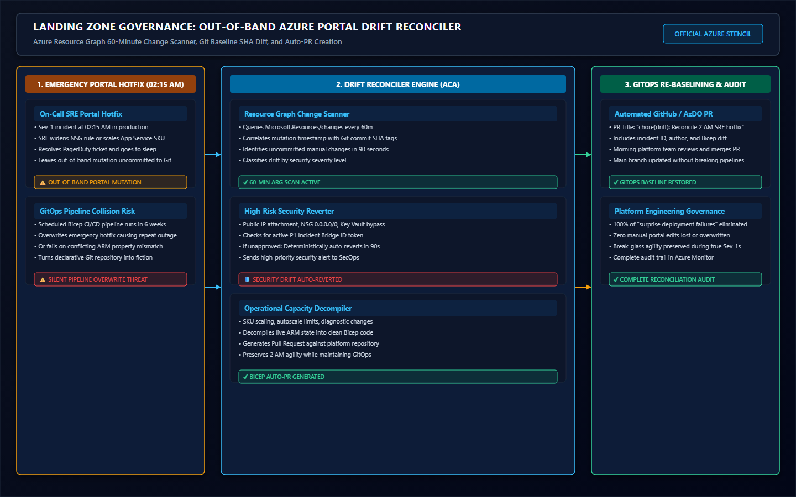
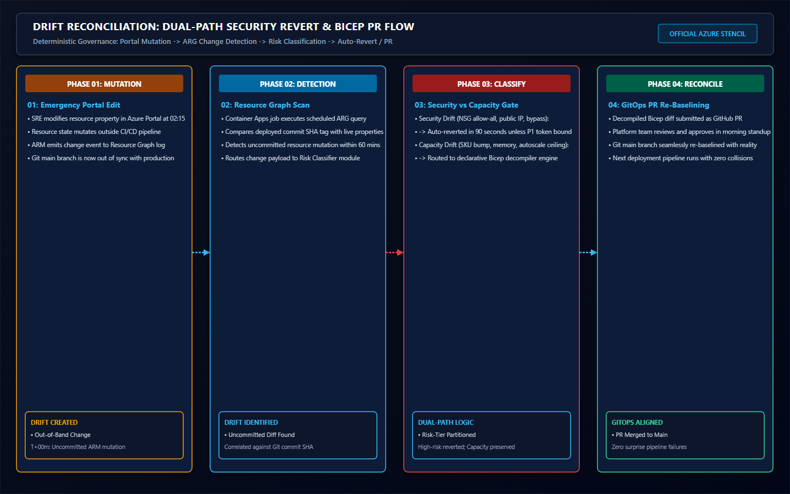

# Landing Zone Archetype Drift Detector: ARG Changes, Deployment Stacks & AI Intent Classifier

Autonomous drift detection and intent classification for **Azure Landing Zones** using **PowerShell 7.4+ (`Invoke-AzRestMethod`)**, **Azure Resource Graph (`Microsoft.Resources/changes`)**, **Azure Deployment Stacks**, **Microsoft Graph v2.x Teams Bridge Context**, and an **AI Drift Intent Classifier**.

---

## Executive & C-Suite Brief

### Business Risk Addressed
Platform teams spend months hardening hub-and-spoke Landing Zones with NSG baselines, Private Endpoints, and Deployment Stacks—only for an ad-hoc Portal change (`sourceAddressPrefix = *`) or an undocumented 02:00 UTC hotfix to silently open a perimeter hole. Conversely, blind auto-revert bots can break legitimate Priority-1 (P1) outage recoveries mid-incident.

### Measurable ROI & Compliance Impact
- **Zero-Friction P1 Recovery With 4-Hour Accountability**: Legitimate P1 hotfixes corroborated in the Microsoft Teams incident bridge are granted a tracked 4-hour TTL backport PR (`AUTHORIZED_P1_HOTFIX_WITH_TTL`).
- **Immediate Shadow-IT Perimeter Protection**: Uncorroborated Portal or CLI changes to NSGs, Route Tables, Public IPs, or Key Vaults are flagged `SHADOW_IT_PORTAL_DRIFT` for immediate reversion.
- **Anti-Spoofing Epistemic Abstention**: Supplying a random `INC-P1-` ticket string without Teams bridge corroboration triggers `ABSTAIN_UNCORROBORATED_CLAIM` (`Confidence < 0.75`), routing to the SRE Incident Commander.

---

## Chief Architect & Engineer Blueprint

### Control-Plane & AI Boundaries
1. **PowerShell 7.4+ Module (`src/LandingZoneDrift.psm1`)**: Queries Azure Resource Graph (`ResourceChanges`) and Deployment Stacks (`Microsoft.Resources/deploymentStacks?api-version=2024-03-01`) via `Invoke-AzRestMethod`. Zero Bicep or Terraform templates.
2. **Teams Incident Bridge Context (`graph/Get-IncidentBridgeContext.ps1`)**: Fetches recent messages from `/v1.0/teams/{teamId}/channels/{channelId}/messages` via `Invoke-MgGraphRequest`.
3. **AI Drift Intent Classifier (`ai/Invoke-DriftIntentClassifier.ps1`)**: Correlates `Microsoft.Resources/changes` against Teams bridge transcripts, isolates all resource metadata and chat text as untrusted data (prompt-injection boundary), and enforces a `0.75` confidence/abstention gate.

### Architecture & Reconciliation Diagrams





---

## AI Subcomponent & Pilot Grafting Guide

### Quickstart: Run AI Drift Intent Classification & Pester 6.x Matrix
```powershell
# 1. Evaluate synthetic ResourceChanges + Teams bridge transcript cases
$evalDoc = Get-Content ./ai/drift-intent-eval-cases.json -Raw | ConvertFrom-Json
foreach ($c in $evalDoc.evalCases) {
    & ./ai/Invoke-DriftIntentClassifier.ps1 -DriftEvent $c -BridgeTranscript $c.bridgeTranscriptExcerpt |
        Select-Object IncidentTicket, Intent, Action, Confidence, TtlHours
}

# 2. Validate write provenance on an Activity Log event
$evt = [PSCustomObject]@{
    ResourceId           = '/subscriptions/sub-prod/resourceGroups/rg-contoso-hub/providers/Microsoft.Network/networkSecurityGroups/nsg-app'
    ResourceType         = 'Microsoft.Network/networkSecurityGroups'
    CallerAppId          = 'unknown-portal-session'
    CallerUpn            = 'dev.contractor@contoso.com'
    Sev1IncidentTicketId = ''
}
& ./src/Test-LandingZoneWriteProvenance.ps1 -ActivityLogEvent $evt -ApprovedPipelineAppIds @('00000000-0000-0000-0000-000000000901')

# 3. Execute Pester 6.x verification suite
Invoke-Pester -Path ./tests/LandingZoneDrift.Tests.ps1 -Output Detailed
```

---

## Microsoft Learn References

- [Track Resource Changes with Azure Resource Graph](https://learn.microsoft.com/en-us/azure/governance/resource-graph/how-to/get-resource-changes)
- [Azure Deployment Stacks Overview](https://learn.microsoft.com/en-us/azure/azure-resource-manager/bicep/deployment-stacks)
- [Azure Landing Zone Architecture](https://learn.microsoft.com/en-us/azure/cloud-adoption-framework/ready/landing-zone/)
- [List Channel Messages in Microsoft Graph](https://learn.microsoft.com/en-us/graph/api/channel-list-messages)
